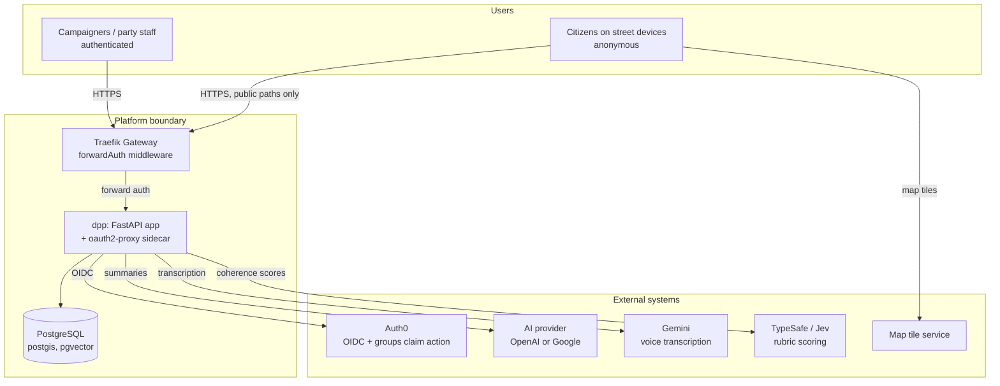

# 3. Context and Scope

## System context

## Actors

| Actor | Surface | Identity |
|---|---|---|
| Party staff (Gliederung members) | All routes except `/crowd/r/*`, `/crowd/api/r/*`, `/healthz` | Authenticated via Auth0 through the forward-auth chain; district memberships from the groups claim |
| Citizens (respondents) | `/crowd/r/{token}` and `/crowd/api/r/*` only | Anonymous; never identified, IP used transiently for rate limiting only (crowd-03) |
| Operator | `kubectl` / `flux` CLI, git | Human operator; secrets via SOPS |

## External systems and what crosses the boundary

| System | Used for | What is sent | What is never sent |
|---|---|---|---|
| Auth0 | Login, sessions, Gliederung membership claim | Standard OIDC traffic | — |
| AI provider (OpenAI *or* Google, deployment-selected) | Campaign list summaries | Campaign canvas fields **except Data Harvest** (adr-04) | Data Harvest, citizen answers, transcripts, locations |
| Google (Gemini) | Voice transcription (transcription-only, independent of `AI_PROVIDER`) | Voice audio for transcription only (adr-07) | Audio retention by the application, citizen answers, locations |
| TypeSafe (System One / Jev) | Initiative domain/narrative coherence scoring (adr-06) | Campaigns labeled `C1..Cn` with Thema/Ziel/Storytelling, initiative name/description | Internal ids, citizen data |
| Map tile service | Analysis map (crowd-05) | Tile requests from the browser | Response data |

## Scope

**In scope (this repository):** the FastAPI application (`app/`), its database migrations, the Docker image, the GitOps manifests for the full stack from Gateway route down to the app container (`k8s/`), and the release pipeline.

**Out of scope:** the Postgres cluster and all cluster plumbing (infra repo `m-gora/cluster-config`), the Auth0 tenant configuration (except the Action documented in `docs/auth0-action.js`), and the party's portal design system (consumed read-only via arch-07).
