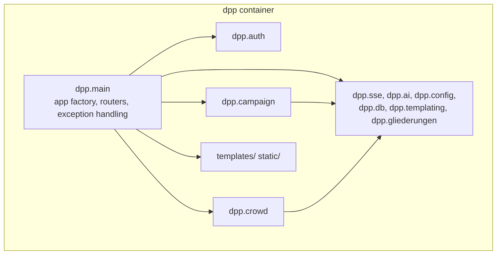
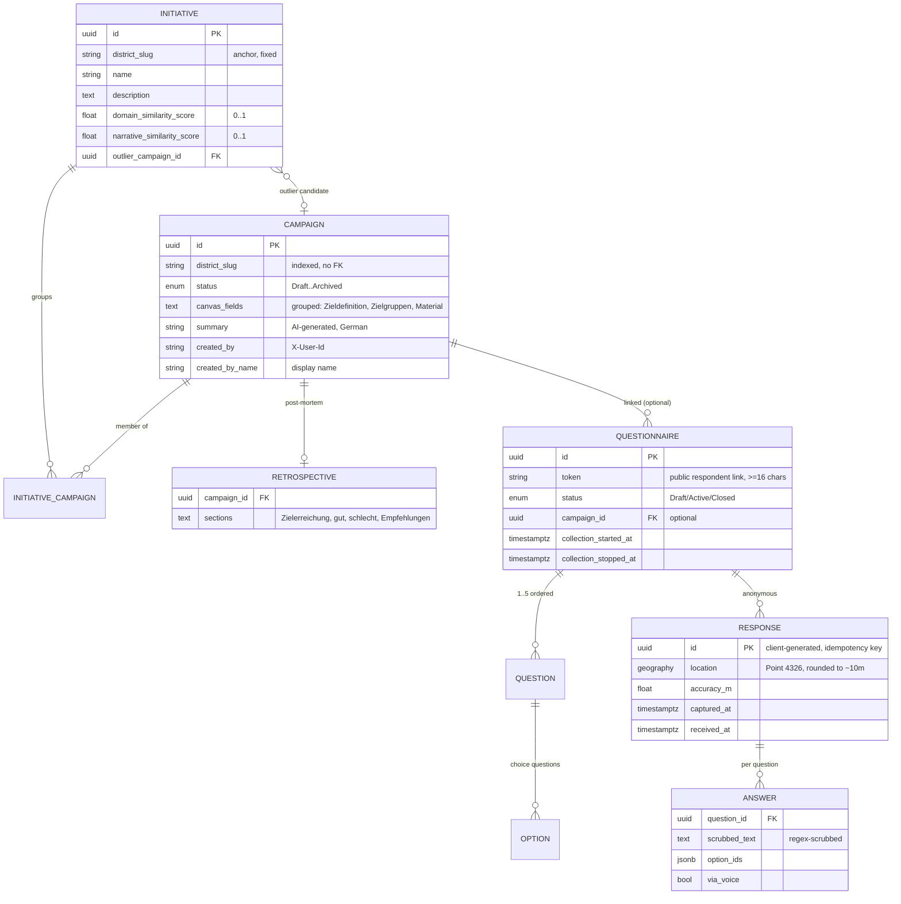

# 5. Building Block View

## Level 1: the whole system

The code is organized **by bounded context, not by technical layer** (`app/README.md`): `campaign/` is the one domain package; `auth/` and the generic infrastructure modules serve it.

## Level 2: building blocks

| Block | Key files | Responsibility |
|---|---|---|
| **main** | `main.py` | FastAPI app factory, router mounting, HTML-aware 401 handling, dev-impersonation wiring (only in `APP_ENV=development`) |
| **auth** | `auth/headers.py`, `auth/dependencies.py`, `auth/dev_impersonation.py`, `auth/router.py` | Parse forward-auth headers into an `Identity` (user id, display name, district scopes); FastAPI dependencies; dev-only personas simulating the proxy |
| **campaign** (bounded context) | `campaign/models.py`, `hierarchy`/scope via `dpp.gliederungen`, `lifecycle.py`, `membership.py`, `coherence.py`, `summary.py`, `events.py`, `router.py` | Districts (slugs), campaigns + lifecycle gating, forking, retrospectives, initiatives + TypeSafe coherence, AI summaries, canvas SSE events, all `/districts`, `/campaigns`, `/initiatives`, `/events/canvas` routes |
| **crowd** (bounded context) | `crowd/models.py`, `service.py`, `scrubber.py`, `ratelimit.py`, `transcribe.py`, `events.py`, `router.py` | Questionnaires, anonymous responses (idempotent, window-checked), regex PII scrubbing, rate limiting, voice transcription, `/crowd/questionnaires`, `/crowd/analysis` (admin) and `/crowd/r/*`, `/crowd/api/r/*` (public) routes |
| **sse** | `sse.py` | Generic in-process pub/sub (`Channel`/`Event`); each module owns its channel |
| **ai** | `ai.py` | Provider abstraction for text generation (OpenAI / google-genai), selected via `AI_PROVIDER`; transcription is a separate `Transcriber` interface (Gemini-only, `crowd/transcribe.py`) |
| **gliederungen** | `gliederungen.py` + `config/gliederungen.yaml` | Immutable in-memory district registry: slugs, display names, hierarchy expansion (`expand`) |
| **config / db / templating** | `config.py`, `db.py`, `templating.py` | Env settings, async SQLAlchemy engine/session, Jinja2 setup |
| **seed / backfills** | `seed.py`, `crowd/seed_demo.py`, `campaign/backfill_*.py` | Idempotent example data and recompute scripts |

## Data model

Derived from the Alembic migrations (`app/migrations/versions/`); districts are **not** tables — they are config slugs referenced by plain indexed string columns (arch-02).

Notable points:

- Campaign canvas fields are gated by lifecycle logic (`campaign/lifecycle.py`), stored per campaign; concurrency is last-write-wins (arch-03).
- Responses store **no identifiers at all**; text is scrubbed server-side before the insert, coordinates rounded to 4 decimals (crowd-03).
- Legacy `domain_embedding`/`narrative_embedding` vector columns exist from early migrations; unused since adr-06 (see [10-risks-and-technical-debt.md](10-risks-and-technical-debt.md)).

## Frontend assets

`templates/` (Jinja2: `base.html` for the admin app, a separate minimal respondent base for `/crowd/r/*`), `static/css` (built Tailwind, crowd CSS kept separate), `static/crowd/` (vendored Leaflet, MarkerCluster, heat plugin with licenses), `static/js` (htmx, SSE/`EventSource` glue, service worker for offline responses).
