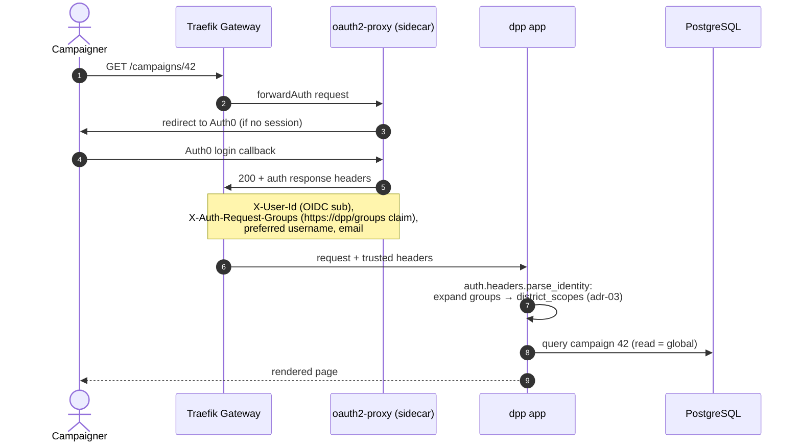
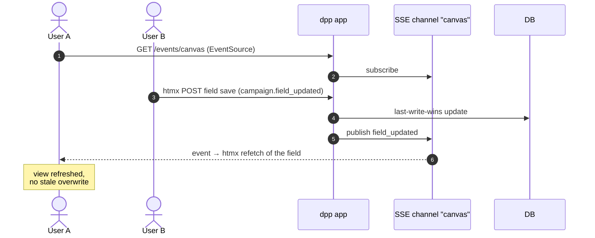
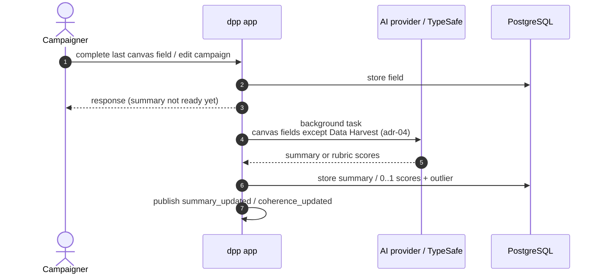
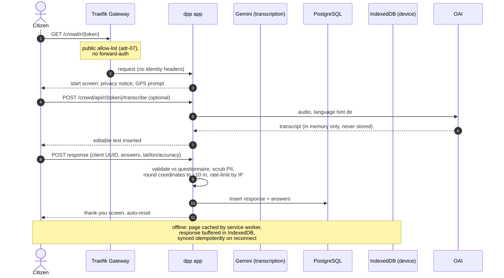
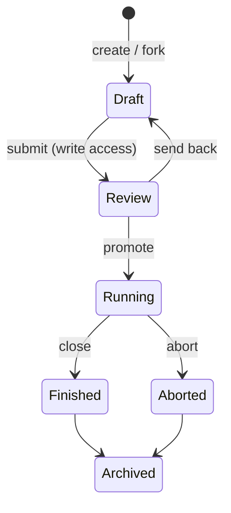

# 6. Runtime View

## 6.1 Authenticated page request (forward-auth chain)

Key points: the app never performs a login and trusts the headers only because it is unreachable except through the proxy chain (arch-01). Write operations additionally run `Identity.has_write_access(district_slug)` against the expanded scope set (arch-02, adr-03). Membership changes in Auth0 take effect at the next login/token refresh.

## 6.2 Concurrent canvas editing (SSE)

The client refetches current state on reconnect; there is no event replay or offset tracking in v1 (arch-03). Status transitions and AI outputs publish `campaign.status_changed` and `campaign.summary_updated` on the same channel; the crowd module uses a separate `crowd` channel.

## 6.3 AI follow-ups (summary, coherence)

Without a configured key the app simply skips the call — outputs stay empty and everything remains usable (adr-05, adr-06). Scores are heuristic LLM judgements; a failed recompute keeps previous values.

## 6.4 Anonymous respondent flow

Late-synced offline responses are accepted only if `captured_at` falls inside the questionnaire's collection window; anything else is rejected with 410 and discarded by the client (crowd-03). `crowd.response_received` is published with questionnaire id and count only.

## 6.5 Campaign lifecycle and questionnaires

Transitioning to `Finished`/`Aborted` auto-creates the retrospective (canv-04) and closes linked Active questionnaires (crowd-01). Questionnaires have their own lifecycle (`Draft → Active ⇄ Closed`); activation of a linked questionnaire is only possible while the campaign is `Running`. Every transition publishes `campaign.status_changed` / `crowd.questionnaire_status_changed`.
