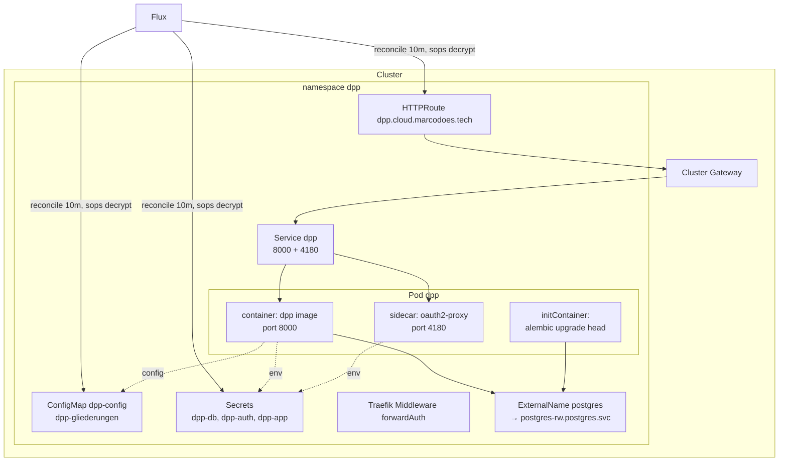
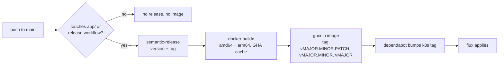

# 7. Deployment View

## Deployment context

The platform runs on a **k3s cluster with Flux** as GitOps controller. This repository owns everything from the Gateway route down to the app container (`k8s/app/`, one Flux Kustomization); the Postgres cluster and general cluster plumbing live in the infra repo (`m-gora/cluster-config`).

## The pod

| Container | Role |
|---|---|
| **initContainer: migrations** | Runs `alembic upgrade head` with the same image, idempotent. Chosen over a k8s Job because Jobs are immutable — a dependabot image bump re-applied by flux would fail on an existing Job (k8s/README.md) |
| **app: dpp** | The FastAPI application, port 8000. `DPP_GLIEDERUNGEN_FILE` points at the ConfigMap-mounted Gliederung YAML |
| **sidecar: oauth2-proxy** | OIDC session handling, port 4180; emits the auth response headers relayed by Traefik (arch-01) |

Both the initContainer and the app use the **same pinned image tag**, so schema and code can never diverge. Dependabot bumps the tag in `deployment.yaml`.

## Image pipeline

Releases are triggered only by changes under `app/**` (and the release workflow itself); infra-only pushes to `main` produce no image. CI runs on every PR/push regardless: pytest against real Postgres, image build, kustomize + dry-run validation of the manifests.

## Ingress and trust boundary

- `HTTPRoute` (Gateway API) → cluster Gateway (Traefik) → `Service` → oauth2-proxy sidecar → app. Public DNS via external-dns at `dpp.cloud.marcodoes.tech`.
- The Traefik `forwardAuth` middleware calls the oauth2-proxy sidecar per request; only the headers listed in `authResponseHeaders` are relayed (arch-01). The container runtime's `/healthz` probe calls the app directly on the Service (note: `k8s/README.md` describes an `httproute-healthz.yaml` that bypasses forward-auth, but it is not yet present in `k8s/app/`).
- **The public allow-list** (`/crowd/r/*`, `/crowd/api/r/*`) must be configured at the proxy so anonymous respondent traffic bypasses forward-auth (adr-07).

## Configuration and secrets

| Kind | Mechanism | Roll behavior |
|---|---|---|
| Non-secret env (app + oauth2-proxy) | `configMapGenerator` → `dpp-config` | Hash-suffixed name → pod rolls on change |
| Gliederung YAML (`DPP_GLIEDERUNGEN_FILE`) | `configMapGenerator` → `dpp-gliederungen` | Same; slugs are stable identifiers — add freely, never rename/remove while referenced (arch-02) |
| Secrets (`dpp-db`, `dpp-auth`, `dpp-app`) | SOPS-encrypted YAML in git; flux decrypts with the age key from `flux-system/sops-age` | Only `data`/`stringData` encrypted, diffs stay reviewable |
| Flux registration (GitSource + Kustomization) | Imperative one-time `flux create` (etcd only) | A cluster rebuild needs the two commands re-run (k8s/README.md) |

## External dependencies at runtime

- Postgres at `postgres-rw.postgres.svc.cluster.local` via an ExternalName alias `postgres`; the DB needs `postgis` and `vector` extensions created before the first migration runs.
- Auth0 tenant (`auth.marcodoes.tech`) with the groups-claim Action from `docs/auth0-action.js`; callback/logout URLs point at the HTTPRoute host.
